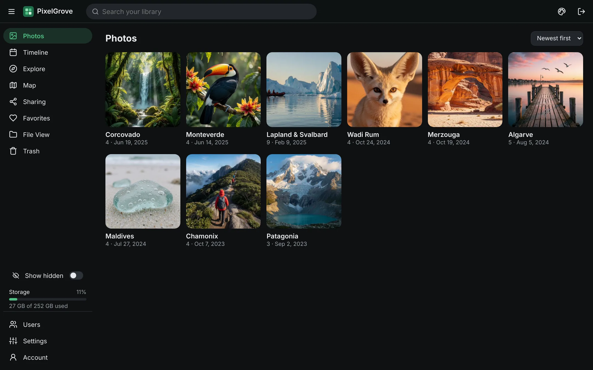
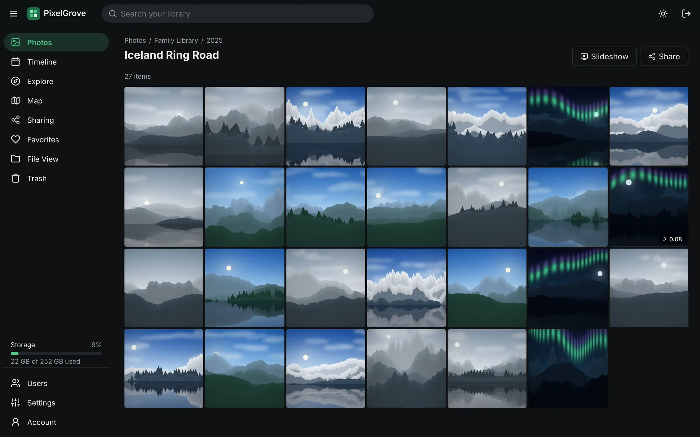
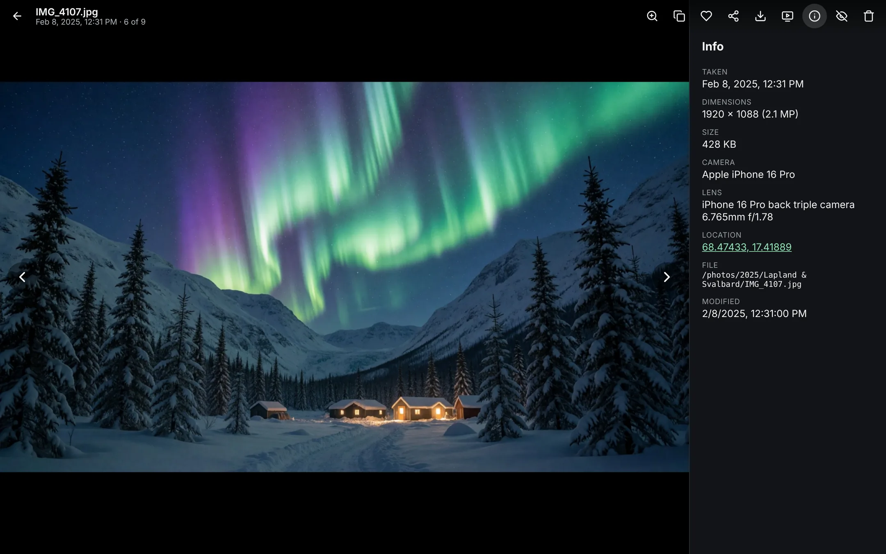
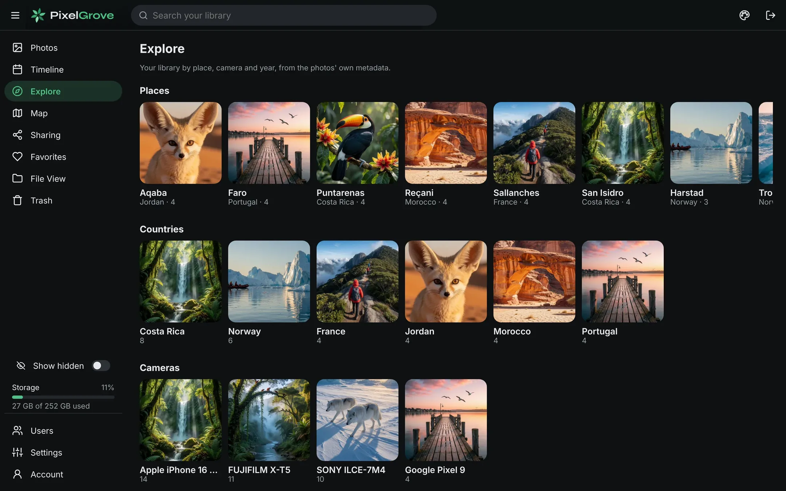
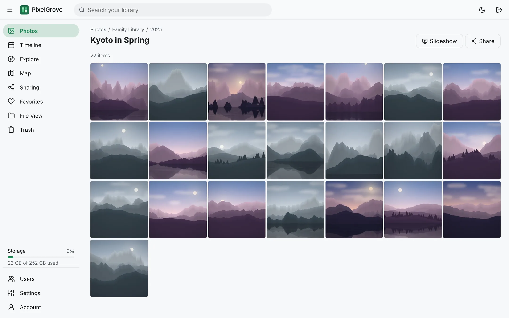
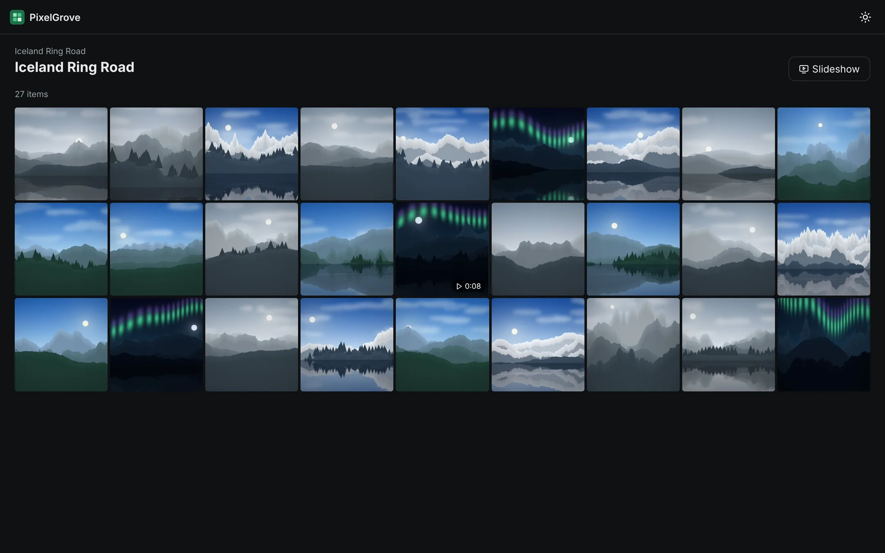
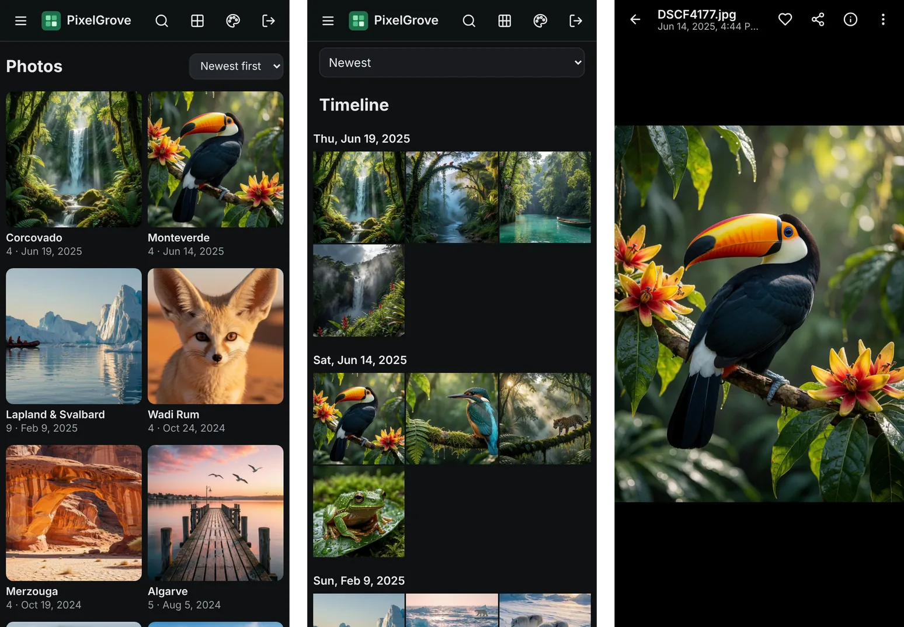

# PixelGrove

An ultra-light, fast, self-hosted photo and video library written in Rust.



- Browse folders the way Android does, plus a timeline, search, map, explore, favorites,
  trash and a File View of the real folder tree.
- Previews are made on the fly and kept only in memory: nothing is written next to your
  photos, and `/config` holds just a small database (about 20 MB for 100k files).
- Share a photo or folder with a link that needs no account.
- Slideshows, dark and light themes, works on phones and installs as an app.
- One small static binary in a `scratch` Docker image, for `linux/amd64` and `linux/arm64`.

> **Status:** all v1 milestones (M0–M8) are complete. See
> [docs/requirements.md](docs/requirements.md) and [docs/plan.md](docs/plan.md).

## Screenshots

| | |
|---|---|
|  |  |
| A folder, newest first; videos show their length | The viewer: zoom, copy, favorite, share, download, slideshow and info |
|  |  |
| Explore by place, country, camera and year, worked out offline | Light theme (dark is the default) |
|  |  |
| A shared folder, as a visitor sees it (no account needed) | On a phone, where it can also be installed as an app |

<sub>The pictures in these screenshots are generated landscapes, not real photos
([how they're made](scripts/screenshots/README.md)).</sub>

## Running with Docker

Copy [docker-compose.example.yml](docker-compose.example.yml) to `docker-compose.yml`,
point the volumes at your photos, then:

```sh
docker compose up -d
```

and open `http://<host>:8080`. Mount your libraries under `/media` and a small directory
at `/config` (database and optional config file). The first scan of ~14k photos takes
seconds on an SSD; on a NAS it's bounded by how fast the disks can read file headers.
Browsing works while it runs.

Without Compose:

```sh
docker run -d --name pixelgrove -p 8080:8080 --user 1000:1000 \
  -v ./pixelgrove-config:/config -v /path/to/photos:/media/photos \
  ghcr.io/singularity098/pixelgrove:edge
```

Images are published to `ghcr.io/singularity098/pixelgrove`: `edge` tracks `main`,
and version tags (`1.2.3`, `1.2`, `latest`) are created from `v*` git tags.

### Media folders

Every directory under `/media` is indexed (set `PIXELGROVE_MEDIA_ROOTS` to change that).
Admins can add other folders under **Settings → Media folders**, with a folder browser;
they just need to be mounted into the container. Folders added there can be removed
again (only from PixelGrove: the files are never touched). Settings also shows library
counts and the last scan, and has **Rescan now**.

PixelGrove watches folders for changes and also rescans everything every 6 hours, since
change notifications don't work on network shares (NFS/SMB). Hidden folders and
`@eaDir`, `#recycle`, `#snapshot` and `lost+found` are skipped; symlinks are not followed.
To leave a folder out, put an empty `.nomedia` or `.ignore` file in it: that folder and
everything below it disappear from PixelGrove (the files are untouched), and come back
if you delete the file.
If a mounted folder goes missing or empty (say a NAS share isn't mounted yet), its
index is kept rather than wiped.

### Behind a reverse proxy

Put PixelGrove behind a proxy with HTTPS (Caddy, Traefik, nginx…) and set
`PIXELGROVE_PUBLIC_URL` to its address. HTTPS is needed for copying photos to the
clipboard and for installing the app; sign-in cookies are marked `Secure` automatically
when the proxy sends `X-Forwarded-Proto: https`. For example, with Caddy:

```
photos.example.com {
    reverse_proxy pixelgrove:8080
}
```

## Accounts

On first visit PixelGrove asks you to create the administrator account (or set
`PIXELGROVE_ADMIN_USER` / `PIXELGROVE_ADMIN_PASSWORD` to create it on start-up). Admins
can add users under **Users**:

| Role | Can |
|---|---|
| Viewer | Browse and download. No changeable options, including their own password. |
| Editor | Also favorites, sharing and trash, and change their own password. |
| Admin | Everything, including settings and user management. |

Any user can be limited to specific folders. Until setup is complete, anyone who can
reach the server can create the admin account, so finish setup before exposing it.

## Trash

Deleting an item moves it into a hidden `.pixelgrove-trash` folder at the top of its
media folder (same volume, so nothing is copied), mirroring where it came from. It can
be restored from **Trash** for 30 days, then it is deleted for good. Trash needs the
media mounted read-write; on a read-only mount (`:ro`) PixelGrove says so and leaves the
file alone. Favorites are per user and stored only in PixelGrove's database.

## Sharing

Editors and admins can share a photo or video (from the viewer) or a folder with
everything below it (from the folder page). Anyone with the link can view it without an
account. Links can expire, need a password, and allow or block downloads (with
downloads off, photos are shown as previews only and videos still play). Folder links
show items added later. Manage links under **Sharing**; admins see everyone's. Set
`PIXELGROVE_PUBLIC_URL` so links use your public address.

Files opened through a share link have their **location removed**: GPS in photos'
EXIF and XMP, and the location phones record in videos. Your files on disk are not
changed, and signed-in users still see where photos were taken.

## Slideshow

Start a slideshow from any folder (**Slideshow** next to the folder name, also on shared
folder links) or from the photo you're viewing (it starts there). Its settings button
picks how long each photo shows (3 s to 1 min), shuffle, whether videos play (to the
end, then it moves on) and whether photos in subfolders are included. The choices are
remembered in the browser. Keys: space pauses, ← → step, Esc ends (and the viewer then
shows the last photo). On phones, swipe to step and tap to show the controls. It goes
full screen where the browser allows and keeps the screen awake.

## Security

PixelGrove is designed to be reachable from the internet for sharing, behind a reverse
proxy with HTTPS (see above). Before opening it up:

- **Finish setup first**, or set `PIXELGROVE_ADMIN_USER` / `PIXELGROVE_ADMIN_PASSWORD`:
  until an admin exists, anyone who reaches the server can create one.
- **Don't publish port 8080 directly**; let only the proxy reach it. PixelGrove takes a
  visitor's address from `X-Forwarded-For` when the connection comes from a private
  network (the proxy), using the rightmost public address, which the visitor can't
  forge.
- Give share links an **expiry** when they're for one occasion. "Downloads off" stops
  originals being downloaded but not screenshots; videos still stream.

What it does for you:

- **Password guessing:** after 10 wrong passwords (sign-in or share-link passwords) a
  visitor's address (or IPv6 /64) is blocked for 15 minutes; you can still sign in from
  elsewhere. An account also locks after 100 failures from all addresses together.
- **Sessions:** Argon2id password hashes; only hashes of session tokens are stored;
  cookies are `HttpOnly`, `SameSite=Lax` and `Secure` behind HTTPS; changing a password
  or disabling a user signs them out everywhere.
- **Browser protections** on every response: a Content-Security-Policy (no inline or
  third-party scripts; only OpenStreetMap tiles from elsewhere), no framing by other
  sites, `nosniff`, `Referrer-Policy: no-referrer` (share links never leak to other
  sites), and HSTS when served over HTTPS. State-changing requests need a custom header,
  which blocks cross-site request forgery.
- **Sharing:** 128-bit random link tokens, nothing outside the shared folder is
  reachable, no server paths or GPS in what visitors see, and location stripped from
  shared files as described above. (Not covered: GPS kept in camera maker notes, or in
  telemetry tracks such as GoPro's.)
- **Container:** a single static binary on an empty `scratch` image, run as your user;
  mount media `:ro` if you don't need Trash.

## Map and Explore

**Map** plots photos that have a GPS location on OpenStreetMap, clustered with a
thumbnail and count; click a cluster to see its photos. Map tiles come from
`tile.openstreetmap.org`, so the browser needs internet access for them (nothing else
about your library is sent anywhere).

**Explore** groups the library by place, country, camera, year and type. Places are
worked out offline at scan time from a bundled table of GeoNames cities (see
[data/README.md](data/README.md)); they're also searchable, e.g. "kyoto" or "france".

## Installing as an app

PixelGrove is a Progressive Web App: in Chrome or Edge use **Install** in the address
bar, on Android **Add to Home screen**, and on iPhone/iPad **Share → Add to Home
Screen**. It then opens in its own window with its own icon. Browsers only allow this
over HTTPS (or on `localhost`), so put PixelGrove behind a reverse proxy with a
certificate to install it from other devices.

## Configuration

Settings come from `/config/pixelgrove.toml` (optional), overridden by environment variables:

| Variable | Default | Description |
|---|---|---|
| `PIXELGROVE_CONFIG_DIR` | `/config` | Database and config file location |
| `PIXELGROVE_BIND` | `0.0.0.0:8080` | Listen address |
| `PIXELGROVE_MEDIA_ROOTS` | `/media` | `:`-separated directories to scan |
| `PIXELGROVE_PUBLIC_URL` | — | External URL used in share links |
| `PIXELGROVE_PREVIEW_CACHE_MB` | `256` | In-memory preview cache size |
| `PIXELGROVE_RESCAN_INTERVAL_HOURS` | `6` | Hours between full rescans |
| `PIXELGROVE_EXCLUDE` | `@eaDir,#recycle,#snapshot,lost+found` | Comma-separated name globs to skip (hidden entries are always skipped) |
| `PIXELGROVE_LOG` | `info` | Log filter (e.g. `debug`) |
| `PIXELGROVE_ADMIN_USER` / `PIXELGROVE_ADMIN_PASSWORD` | — | Creates this admin on first start, instead of the setup screen |

Apart from `PIXELGROVE_LOG` and the `PIXELGROVE_ADMIN_*` variables, the same keys (lower-case, without the prefix) can be used in `pixelgrove.toml`.

## Development

Requirements: Rust (stable, ≥ 1.88) and Node.js 22.

```sh
# Backend on :8080 (serves the UI from web/dist if it has been built)
PIXELGROVE_CONFIG_DIR=./dev-config PIXELGROVE_MEDIA_ROOTS=~/Pictures cargo run

# Frontend with hot reload on :5173, proxying /api to :8080
cd web && npm install && npm run dev
```

Checks run in CI: `cargo fmt --check`, `cargo clippy --all-targets -- -D warnings`,
`cargo test`, and `npm run check && npm run build` in `web/`.

To benchmark the indexer, generate a synthetic library and point a release build at it:

```sh
python3 scripts/gen-bench-library.py /tmp/bench-lib 100000
PIXELGROVE_CONFIG_DIR=/tmp/bench-cfg PIXELGROVE_MEDIA_ROOTS=/tmp/bench-lib cargo run --release
curl localhost:8080/api/library/status
```

A release build (`cd web && npm run build && cd .. && cargo build --release`) embeds the
UI in the single `pixelgrove` binary.

## License

[MIT](LICENSE). Place data © GeoNames (CC BY 4.0); map data © OpenStreetMap contributors.
